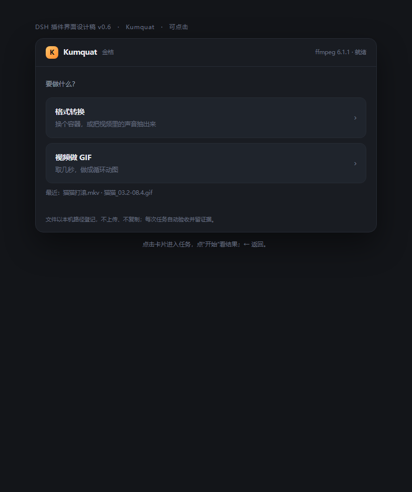

# Kumquat（金桔）

DeepSeek Harness 的媒体插件：**格式转换**与**视频取景做 GIF**，产物出厂前自动验收。



## 它做什么

**格式转换**：MP4 / MKV / MOV / WEBM / AVI 互转，MP3 / M4A / WAV / FLAC 互转，视频选 MP3 即抽音频。
目标容器装得下就流拷贝（百毫秒级），装不下明确告知并重编码，不偷偷降级。

**取段做 GIF**：拖时间轴选几秒，帧率与宽度可调；超出目标体积自动降宽重试，最多两轮，然后告诉你还差多少。

## 为什么不是又一个转码工具

同类工具返回“成功/失败”；Kumquat 返回**期望值、实际值、差多少、怎么修**：

- 分辨率、编码、帧率、时长、声道、采样率逐项比对；
- 可解码性抽样检查，不用全片解码；
- 每条产物落一份 `verify.json`：完整 argv、FFmpeg 版本、逐项判定，失败可复现；
- 结论不合格时，能自动修的给修复方案，不能修的给一句人话和下一步。

## 安装

要求 DSH 0.2.x、Node 20.12 以上。插件本身零依赖，不需要 `npm install`。

```bash
# 从仓库本地安装（当前方式）
dsh plugin --profile desktop add file:C:/path/to/dsh-kumquat
dsh plugin --profile web add file:C:/path/to/dsh-kumquat
```

桌面客户端也可以在插件面板里指向本地目录安装。装完重启，侧栏出现「金桔」。

## 使用

1. 侧栏点「金桔」；
2. 选任务：格式转换 / 视频做 GIF；
3. 点「添加文件」填绝对路径（宿主没有文件选择器），或点「粘贴路径」；
4. 选目标格式或拖时间轴选区；
5. 点开始，结果挂在表单下面，点开看验收细目。

成品默认写在**源文件旁边**。`Downloads` 常被 Windows「受控文件夹访问」拦截，ffmpeg 会写不进去，所以没有把它作为默认。

## FFmpeg

优先使用本机已有的 `ffmpeg`；找不到时按平台自动下载并校验 sha256：

| 平台 | 自动安装 | 来源 |
|---|---|---|
| Windows x64 | 支持 | gyan.dev essentials |
| Linux x64 / arm64 | 支持 | BtbN |
| macOS | 不支持自动安装 | 需 `brew install ffmpeg` 或配置 `ffmpegPath` |

下载只解压 `ffmpeg` 与 `ffprobe`，不执行归档内其他文件；大小上限 200MB；失败自动清理。

## 兼容

DSH 桌面客户端与 `dsh web` 共用同一份客户端 bundle。文件以本机绝对路径登记，不上传、不复制。

## 安全与隐私

- 唯一的网络出口是余额查询 `GET https://api.deepseek.com/user/balance`，仅在拿到 key 时发起；
- 默认复用 Harness 凭据里已保存的 `DEEPSEEK_API_KEY`，通常不需要单独配置；插件配置或环境变量可以覆盖它；
- 未配置 key 时余额行直接隐藏，不会出现“未配置”提示，也不会有任何相关请求；
- key 只在宿主进程内存中拼 Bearer 头，**不下发浏览器、不进日志**；
- 仓库里只有 `sk-...` 占位符，真实 key 请用环境变量 `DEEPSEEK_API_KEY` 或 profile 配置；
- 不采集遥测，不上传媒体文件。

详见 [SECURITY.md](SECURITY.md)。

## 验证

- 单元测试 339 条、端到端 16 条（Windows 实测）；
- 覆盖：格式转换、GIF 取段与体积闭环、取消与临时文件清理、并发隔离、坏样本错误语义、宿主路由与注入；
- 验证记录见 [docs/VERIFICATION.md](docs/VERIFICATION.md)。

Linux 只做了逻辑验证，macOS 未上机。

## 开发

```bash
node scripts/make-fixtures.mjs
node --test --test-isolation=none "test/unit/*.test.mjs"
node --test --test-isolation=none "test/e2e/*.test.mjs"
```

沙箱里 `node --test` 会为每个文件 spawn 子进程，可能报 `EPERM`；用 `--test-isolation=none` 在当前进程内跑。

## 目录

```
src/engine/   ffmpeg 定位、探测、能力、参数构造、进程执行
src/verify/   验收检查、容差、修复、证据
src/binary/   FFmpeg 按平台下载、校验、解压
src/host/     DSH 宿主接线、路由、余额
src/client/   三屏界面
test/         单元与端到端
design/       设计稿与界面稿
docs/         插件详情页、内部记录
```

## License

MIT

