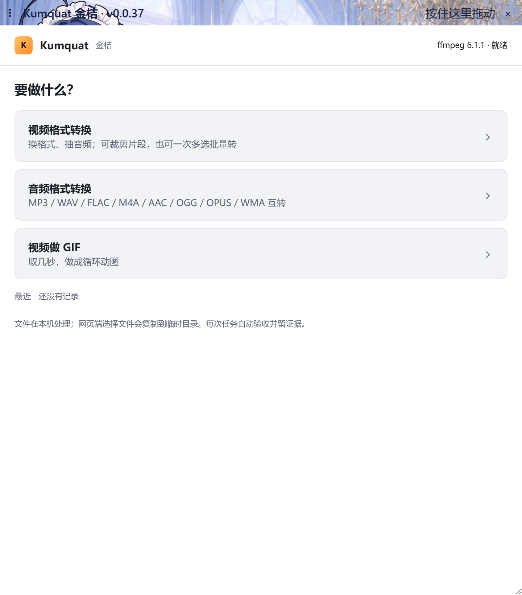



# Kumquat

Change a format, or cut a few seconds into a GIF; then have it checked.

Three tasks, three screens: pick a task, answer the one required question, read the result under the form. It is not a media toolbox.

## The three tasks

### Video format conversion

Turn a video or audio file into another container:

- Video: MP4, MKV, MOV, WEBM, AVI
- Audio output: MP3, M4A, WAV, FLAC, AAC, OGG, OPUS, WMA

One required answer: the target format. When a stream copy is possible it is the default (`-c copy`, done in seconds); when it is not, the panel states why and re-encodes for the target container. Choosing MP3 for a video extracts its audio — there is no separate "extract audio" entry.

### Audio format conversion

MP3, M4A, WAV, FLAC, AAC, OGG, OPUS and WMA convert into each other; video and audio only, no picture.

Video conversion can also trim a segment (start/end, re-encoded for an accurate cut) and batch several files with one target; each file gets its own verdict.

### Video to GIF

Selection, frame rate, and width; everything else is fixed:

- A selection is required. The default is 00:00 plus 5 seconds. Typing and dragging stay in sync.
- Defaults are 12 fps and 480 px wide, roughly 1.2 MB per second.
- A GIF always loops, uses 256 colours, and has no audio; the panel says so.
- With a target size the tool closes the loop: lower the width (×0.85), then the frame rate, at most twice; if it still does not fit it reports the gap instead of claiming success.

Hard limits at the API boundary: a segment of at most 10 minutes, 1–60 fps, 16–1920 px wide.

## Reading the verification

Every finished task is verified automatically. The verdict is one badge on the result row; details open on demand:

- **✓ Pass**: every required check matched.
- **⚠ Warn**: usable but off, for example duration drift from a stream copy, or a variable-frame-rate source.
- **✕ Fail**: the output is not usable — undecodable, missing an audio stream, wrong dimensions.
- **— Skipped**: nothing was requested at that tier; a full decode in particular runs only on request.

Each check reports four things: what was expected, what was measured, how far off it is, and how to fix it. Three tiers:

| Tier | What it checks | Rough cost |
|---|---|---|
| L0 | Container, streams, duration, size (ffprobe) | Hundreds of milliseconds |
| L1 | Full audio decode plus three video samples | Under a second to a few seconds |
| L2 | Full decode | About 9% of the duration |

Repair suggestions are executable next steps: how many decibels of gain, whether to re-encode, which step to rerun. Every task leaves `job.json`, `verify.json`, and the full argv, so it can be reproduced elsewhere.

## The balance widget

The panel can show the DeepSeek account balance. It is optional: without a key it reads "not connected" and nothing else changes.

**Configuring the key** (pick one; the environment variable is preferred):

```bash
# Preferred: no secret written into the plugin configuration
DEEPSEEK_API_KEY=sk-...
```

```yaml
# Or in the plugin configuration
- id: kumquat
  name: dsh-kumquat
  config:
    apiKey: sk-...
```

Rules:

- The request happens in the Host process only: `GET https://api.deepseek.com/user/balance`, Bearer authentication, 5-second timeout.
- The key never reaches the client, never appears in a log, and never appears in a response. The panel can only learn whether a key is configured.
- The result is cached for 30 seconds (`balanceRefreshMs` changes that). Failures degrade silently to "not connected"; they never raise an error or block the panel.
- Balance is optional; the only other network access is the official FFmpeg download when none is installed.

## Dependencies and network

- **No third-party dependencies**: the runtime uses Node built-ins only, no npm packages, no install scripts. React comes with the DSH client.
- **No network traffic** beyond the balance query: no analytics, no update checks, no uploads.
- **Local files only**: it reads the files you select and writes into the output directory. Conversions accept no filter strings, GIF options are whitelisted fields, and nothing is ever concatenated into a shell command.

## FFmpeg

FFmpeg is an external program, not a dependency. Lookup order: `ffmpegPath` from configuration → system PATH and common install locations → otherwise a platform build downloaded from the official source.

- Installs go to `~/.dsh/kumquat/bin/<platform>-<arch>/`. Only `ffmpeg` and `ffprobe` are extracted, the archive is checked against sha256, and a `-version` run must succeed.
- A banner shows size and progress, and the original task continues automatically afterwards. Only one install runs at a time.
- To stay offline: set `autoDownload: false` and the panel only explains the gap with copyable instructions, or point `ffmpegPath` at an existing binary.
- The downloaded build is GPL. The plugin does not bundle or redistribute it; it only fetches it on your machine. Distribution compliance depends on how you use it.

## Fonts

The plugin **bundles no fonts**. The interface uses the system font stack and follows your system language and text-size settings. Neither the documentation nor the interface suggests installing or distributing copyrighted font files; if a specific typeface is needed, check its licence yourself.

## Known limits

- Two tasks only: format conversion and GIF segments. Cropping, concatenation, vertical video, batches, and subtitles are out of scope for now.
- No intra-file parallel encoding: measured at about 1.06×, and it makes output irreproducible. Concurrency happens between tasks, with a default of `clamp(cores/2, 1, 4)`.
- Cancellation targets one job. A failed job does not block the queue.
- The output directory defaults to `Kumquat/` inside the platform download folder; `outputDir` changes it.
- macOS and Linux share the same abstraction but have only been exercised on Windows.

