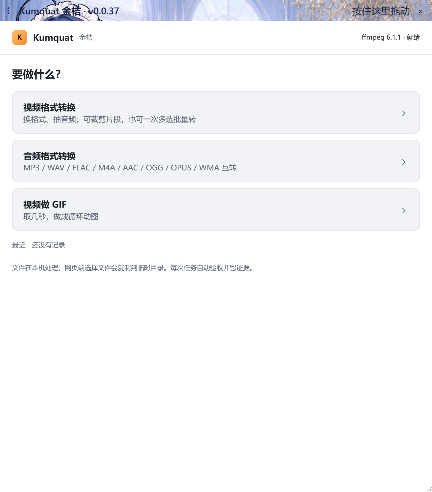



# 金桔 Kumquat

换个格式，或取几秒做成 GIF；做完自动验一遍。

三个任务，三块屏幕：选任务、填一个必答项、结果挂在表单下方。它不试图成为媒体工具箱。

## 三个任务

### 视频格式转换

把一个视频或音频文件换成另一种容器：

- 视频：MP4、MKV、MOV、WEBM、AVI
- 音频（抽声音）：MP3、M4A、WAV、FLAC、AAC、OGG、OPUS、WMA

只有一项必答：转成什么。能只换封装时默认只换封装（`-c copy`，秒级完成）；不能时面板会写明原因，再按目标容器重编码。视频选音频格式就是从视频里抽声音，不另设「提取音频」入口。

- 可选「裁剪片段」：填起止时间，只转中间一段；裁剪会自动重编码，验收按裁剪后时长。
- 可批量：一次多选文件，按同一格式依次提交，结果逐条验收、逐条取消。

### 音频格式转换

MP3、M4A、WAV、FLAC、AAC、OGG、OPUS、WMA 八种互转，只处理声音，不保留画面。

### 视频做 GIF

选区、帧率、宽度三项，其余固定：

- 必须先有选区，默认 00:00 起 5 秒；起止可手填也可拖动，两者双向同步。
- 默认 12 fps、480 px 宽，通常 1.2 MB/秒左右。
- GIF 固定循环、256 色、没有声音，界面上直接写明。
- 填了目标体积就闭环：超了先降宽度（×0.85），再降帧率，最多两轮；仍超就报差多少，不假装成功。

单次最长 10 分钟、帧率 1–60、宽度 16–1920，这些是接口层的硬边界，超出会在开始前被拒绝。

## 验收怎么读

每次任务结束自动跑验收，结论是结果行上的一枚徽章，点开才看细目：

- **✓ 通过**：所有必检项符合期望。
- **⚠ 注意**：能用，但有偏差，例如只换封装导致的时长漂移、源文件可变帧率。
- **✕ 不通过**：产物不可用，例如无法解码、缺音频流、尺寸不对。
- **— 跳过**：这一档没有要求检查，例如没有显式要求就不做全片解码。

每条检查都写四件事：期望什么、实际是什么、差多少、怎么修。分三档：

| 档 | 查什么 | 大约耗时 |
|---|---|---|
| L0 | 容器、流、时长、体积等元数据（ffprobe） | 百毫秒级 |
| L1 | 音频全解码 + 视频抽三段解码 | 亚秒到数秒 |
| L2 | 全片解码 | 约片长的 9% |

修复建议只给可执行的下一步：增益多少分贝、要不要重编码、重跑哪一步。每次任务同时留下 `job.json`、`verify.json` 与完整 argv，换台机器也能复现。

## 余额组件

面板标题栏可以显示 DeepSeek 账户余额。它是可选件：没有配 key 就整行隐藏，其余功能完全不受影响。

**key 怎么配**（二选一，推荐环境变量）：

```bash
# 推荐：不落盘到插件配置里
DEEPSEEK_API_KEY=sk-...
```

```yaml
# 或写进插件配置
- id: kumquat
  name: dsh-kumquat
  config:
    apiKey: sk-...
```

规则：

- 请求只发生在宿主进程：`GET https://api.deepseek.com/user/balance`，Bearer 认证，5 秒超时。
- key 不下发客户端、不写日志、不进任何接口响应；面板只能知道「有没有配」。
- 结果缓存 30 秒（`balanceRefreshMs` 可调），失败静默降级为「未连接」，不弹错、不阻塞面板。
- 余额是可选网络请求；另有本机缺 FFmpeg 时的官方构建下载。

## 依赖与网络

- **零第三方依赖**：运行时只用 Node 内置模块，没有 npm 包，不执行安装脚本。React 由 DSH 客户端自带。
- **不联网**：除了上面的余额查询，插件不发起任何网络请求；不埋点、不检查更新、不上传文件。
- **本地文件**：只读你选中的文件，只写输出目录。转换不接受滤镜串，GIF 参数走白名单，绝不拼接 shell 命令。

## FFmpeg

FFmpeg 不是依赖包，是外部程序。查找顺序：配置里的 `ffmpegPath` → 系统 PATH 与常见安装目录 → 都没有则按平台从官方构建源下载。

- 下载安装到 `~/.dsh/kumquat/bin/<平台>-<架构>/`，只取 `ffmpeg` 与 `ffprobe`，校验 sha256 后跑一次 `-version` 才算装好。
- 面板顶部横幅显示体积与进度，装完自动继续原来的任务；同一时间只跑一个安装任务。
- 不想联网：配置 `autoDownload: false`，缺失时只提示，并给出可复制的安装指引；或直接把 `ffmpegPath` 指向已有可执行文件。
- 下载的是 GPL 构建，插件本身不打包、不再分发，只在你的机器上代取。分发合规由你的使用场景决定。

## 字体

插件**不打包任何字体**，界面使用系统字体栈，跟随你的系统语言与字号设置。文档与界面都不建议安装或分发有版权的字体文件；需要特定字体时请自行确认授权。

## 已知边界

- 只做三件事：视频格式转换（含裁剪、批量）、音频格式转换、取段做 GIF；拼接、竖屏、字幕不在范围内。
- 加密或私有外壳的 .vdat / .sdv 解不开，需先用原厂工具导出 MP4。
- 不做单文件分段并行编码：实测收益约 1.06×，还会让产物不可复现。并发发生在任务之间，默认并发度为 `clamp(核数/2, 1, 4)`。
- 取消按任务精确执行，一个任务失败不影响队列里的其他任务。
- 输出位置可在界面里用系统「另存为」指定；不指定则写在源文件旁边，目录不可写时自动换到可写目录并说明。
- macOS 与 Linux 走同一套抽象，但当前只在 Windows 上实测过。

